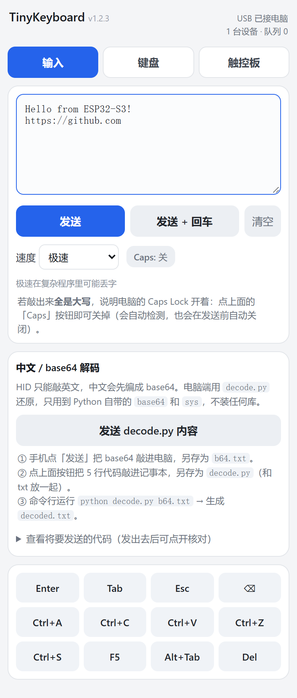
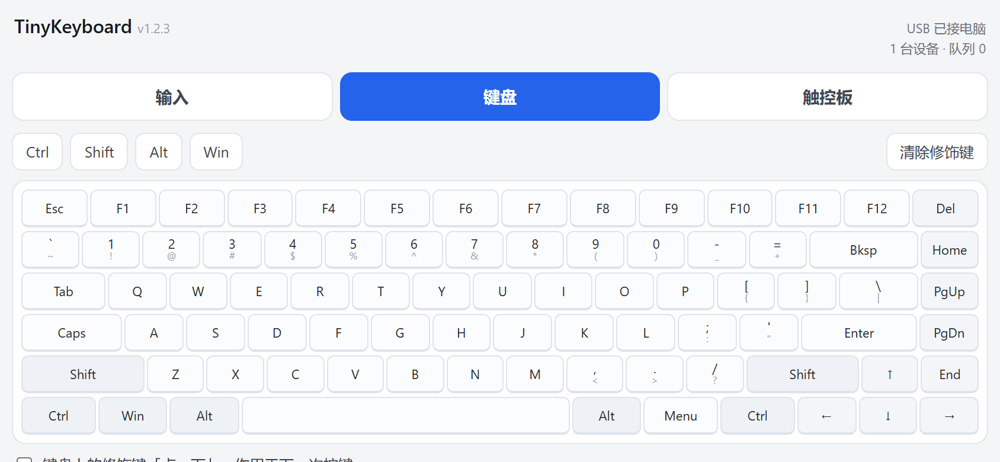
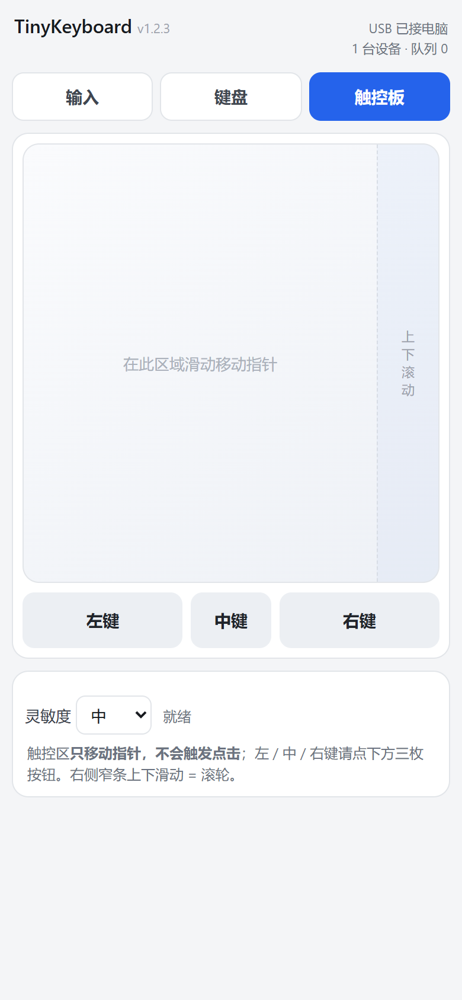

# TinyKeyboard · ESP32-S3 网页 HID 键鼠套装

把一块 ESP32-S3 开发板变成 **免驱的 USB 键盘 + 鼠标**，用手机浏览器通过 WiFi 热点远程操控电脑。

插上板子，电脑把它认成一把「罗技 USB 键盘」+ 一个「USB 鼠标」；手机连上板子开的 WiFi 热点，打开 `http://192.168.4.1`，就能：

- **输入**：粘贴/输入一段文字，被逐字「敲」进电脑；含中文自动转 base64
- **键盘**：75 配列虚拟键盘，支持组合键、粘滞修饰键、长按连发
- **触控板**：手机屏幕当触摸板，控制电脑鼠标（指针 + 滚轮 + 左/中/右键）

> 典型场景：给工控机、矿机、KVM 目标机、无键鼠的服务器临时输入；或把手机当应急键鼠。

---

## 特性

- **免驱即插即用**：标准 HID 复合设备（Boot 键盘 + 报表鼠标），BIOS/UEFI、Windows/macOS/Linux 均无需装驱动
- **中文输入**：HID 只能敲 ASCII，中文自动 base64 编码，电脑端用 5 行 Python 脚本一键还原
- **完整虚拟键盘**：75 配列、组合键、粘滞修饰键、长按连发、Caps Lock 状态自动同步
- **触控板**：相对位移 + 滚轮 + 三键，灵敏度可调
- **Caps Lock 自动纠正**：从主机 LED 报告读取状态，发送前自动关掉，避免小写被翻成大写
- **双实现**：ESP-IDF（主实现）+ Arduino/PlatformIO（简化版），按需选择
- **极速输入**：FreeRTOS tick 提到 1000 Hz，按键间隔低至 1 ms

## 实际效果

| 输入 | 键盘 | 触控板 |
|:---:|:---:|:---:|
|  |  |  |

## 硬件要求

| 项目 | 说明 |
|:---|:---|
| 主控 | ESP32-S3 DevKitC-1（N16R8，16 MB Flash / 8 MB PSRAM） |
| 端口 | **左** USB-C（UART0，GPIO43/44）→ 烧录；**右** USB（原生 OTG，GPIO19/20）→ 接目标电脑 |
| 供电 | 目标电脑 USB 或外部电源 |

> 烧录走左侧 COM 口（板载 CH343），右侧 USB 口留给目标电脑做 HID，两者互不干扰。

## 目录结构

```
esp32s3_key_send/
├── CMakeLists.txt            # ESP-IDF 顶层构建脚本
├── partitions.csv            # 自定义分区表（应用区 2 MB）
├── sdkconfig.defaults        # 默认 sdkconfig（目标板/Flash/HID 等）
├── decode.py                 # 电脑端 base64 解码脚本（仅用 Python 标准库）
├── main/                     # ESP-IDF 主实现
│   ├── CMakeLists.txt        #   组件注册 + index.html 内嵌
│   ├── idf_component.yml     #   依赖声明（esp_tinyusb / mdns）
│   ├── main.c                #   固件：USB HID + WiFi AP + HTTP 服务
│   └── index.html            #   网页控制界面（编译时内嵌进固件）
├── arduino/                  # Arduino / PlatformIO 简化版
│   ├── platformio.ini
│   └── firmware/esp32_key_send/esp32_key_send.ino
└── docs/
    ├── requirements.md       # 需求文档
    ├── development.md        # 开发文档
    └── images/               # 实际使用截图
```

## 快速开始

### 环境依赖

- ESP-IDF **5.5.x**（本项目在 v5.5.5 上构建通过）
- 工具链：ESP32-S3（`idf.py set-target esp32s3`）

### 编译 & 烧录（ESP-IDF）

```bash
# 1. 激活 ESP-IDF 环境
. $IDF_PATH/export.sh          # Windows: %IDF_PATH%\export.bat

# 2. 设置目标芯片（首次）
idf.py set-target esp32s3

# 3. 编译
idf.py build

# 4. 烧录（左侧 COM 口）
idf.py -p PORT flash

# 5. 查看串口日志（可选）
idf.py -p PORT monitor
```

### 编译 & 上传（Arduino / PlatformIO）

用 VS Code + PlatformIO 打开 `arduino/` 目录，或直接用 Arduino IDE 打开 `arduino/firmware/esp32_key_send/esp32_key_send.ino`，选择 `esp32-s3-devkitc-1` 开发板即可。

---

## 使用说明

1. **接线**：右侧 USB 口接目标电脑，左侧 COM 口接电脑烧录（烧录完可拔掉左侧）。
2. **连热点**：手机连 WiFi `TinyKeyboard`（密码 `wenqi777`）。
3. **打开网页**：浏览器访问 `http://192.168.4.1`（或 mDNS 地址 `http://espkb.local`）。
4. **使用**：
   - 「输入」页：粘贴文字 → 选速度 → 点「发送」；中文会自动转 base64。
   - 「键盘」页：点虚拟按键；上方 Ctrl/Shift/Alt/Win 是粘滞开关（组合键）。
   - 「触控板」页：滑动移指针，右侧窄条滚轮，下方三键点击。

### 中文 / base64 解码

HID 只能敲英文，中文会先编成 base64。电脑端还原只需 3 步（脚本只用 Python 标准库，无需装任何包）：

```bash
# ① 手机点「发送」把 base64 敲进电脑，另存为 b64.txt
# ② 把仓库里的 decode.py 拷到电脑（或点页面「发送 decode.py 内容」敲进记事本另存）
# ③ 命令行运行
python decode.py b64.txt        # → 生成 decoded.txt（UTF-8）
```

---

## 已知限制

- **仅 US 键盘布局**：发送的是 US 扫描码，目标机若用其它布局（如英式、法式），符号会错位。
- **中文需解码**：HID 通道只支持 ASCII，中文经 base64 编码后需电脑端脚本还原。
- **VID/PID 借用**：默认伪装成罗技 K120（`046D:C31C`）。自用无妨，**做成商品请勿冒用他厂 VID**。

## 文档

- [需求文档](docs/requirements.md) — 需求背景、功能/非功能需求、接口与约束
- [开发文档](docs/development.md) — 架构、模块划分、HTTP/HID 接口、配置项、FAQ

## 许可证

本项目基于 [MIT License](LICENSE) 开源，可自由使用、修改与商用（需保留版权声明）。

> ⚠️ 注意：源码默认借用罗技 K120 的 USB VID/PID（`046D:C31C`），自用无妨；**商用前请改用自有（或 USB-IF 授权的）USB 标识**，避免侵权。

---

*Firmware version：1.2.3 · Target：ESP32-S3 (N16R8) · IDF：5.5.x*
