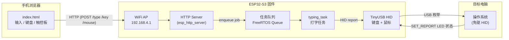

# 开发文档

> 项目：TinyKeyboard —— ESP32-S3 网页 HID 键鼠套装
> 版本：1.0 · 对应固件 1.2.3 · 更新时间：2026-11-19

---

## 1. 架构总览

系统由「目标电脑 ↔ USB HID」与「手机浏览器 ↔ WiFi AP + HTTP」两条链路组成，固件在中间做桥接。



**设计要点**

- **解耦**：HTTP 请求处理与实际的 HID 发送通过 FreeRTOS 队列解耦，HTTP 任务只入队、打字任务统一出队发送，避免阻塞与并发写冲突。
- **互斥**：TinyUSB 端点非线程安全，打字任务与 `/mouse` 直发都可能写端点，故用互斥锁 `s_hid_mutex` 串行化。

---

## 2. 目录结构

```
esp32s3_key_send/
├── CMakeLists.txt            # 顶层构建；MINIMAL_BUILD 只编译 main 及其依赖
├── partitions.csv            # 分区表：nvs / phy_init / factory(2MB)
├── sdkconfig.defaults        # 默认配置（目标板、Flash、HID、tick 等）
├── decode.py                 # 电脑端 base64 解码脚本
├── dependencies.lock         # 依赖版本锁（需提交）
├── main/
│   ├── CMakeLists.txt        # idf_component_register：SRCS=main.c，EMBED_FILES=index.html
│   ├── idf_component.yml     # 依赖：esp_tinyusb ^2.0.0、mdns ^1.8.0
│   ├── main.c                # 固件主程序（约 690 行）
│   └── index.html            # 控制网页（编译时作为二进制内嵌）
├── arduino/                  # Arduino / PlatformIO 简化版
│   ├── platformio.ini
│   └── firmware/esp32_key_send/esp32_key_send.ino
└── docs/                     # 本文档目录
```

---

## 3. 核心模块设计

### 3.1 USB HID 层

- 采用 **两个独立 HID 接口**（而非一个接口内塞两个 Report ID）：
  - 接口 0（ITF_KEYBOARD）：Boot 键盘，端点 `0x81`，报告 8 字节，兼容 BIOS/UEFI；
  - 接口 1（ITF_MOUSE）：报表鼠标，端点 `0x82`，带滚轮。
- 端点间隔 1 ms，与主流 1000 Hz 键鼠一致。

**设备描述符**（`main.c`）：

```c
#define USB_VID 0x046D   /* Logitech */
#define USB_PID 0xC31C   /* K120 有线办公键盘 */
```

**TinyUSB 回调**：实现 `tud_hid_descriptor_report_cb`（按实例返回键盘/鼠标报表描述符）、`tud_hid_get_report_cb`、`tud_hid_set_report_cb`（接收主机 LED 状态）。

### 3.2 键码转换

- `ascii_to_hid(c, &key, &shift)`：把 ASCII 字符映射为 HID 键码 + 是否需要 Shift，覆盖字母、数字与常见符号（见 `ASCII_MAP` 表）。
- `lookup_key(name, &auto_shift)`：把键名（`enter`/`f5`/`up`…）或单字符映射为键码；单字符保留大小写，多字符键名转小写匹配。
- **修饰键单点**：`ctrl`/`shift`/`alt`/`gui`(win) 走「modifier 字节置位 + keycode 数组全 0」的报告，不能把 `0xE0~0xE3` 塞进 keycode 数组（部分主机会忽略）。

### 3.3 任务队列与打字任务

```c
typedef struct {
    uint8_t kind;       // 0=文本, 1=单键/组合键
    uint8_t key;        // HID 键码
    uint8_t mod;        // 修饰键掩码
    uint8_t delay_ms;
    char  *text;        // kind=0 时有效
    size_t len;
} job_t;
```

- `s_queue`：长度 8 的指针队列；HTTP 任务 `enqueue_job()` 入队，`typing_task` 出队执行。
- `type_text()`：逐字符调用 `tap_key()`；`delay_ms<=1` 时按下保持 1 ms（极速档），否则 3 ms。
- 发送前先 `kb_report(0, nokeys)` 清掉残留 Shift/Ctrl 状态，发送后再清一次。

### 3.4 HTTP 服务

- 基于 `esp_http_server`，栈 6144 B，`max_uri_handlers=8`，开启 LRU purge。
- `index.html` 通过 `EMBED_FILES` 编译成 `.S` 汇编内嵌进固件，运行时从 `_binary_index_html_start/_end` 读出返回。

### 3.5 WiFi AP 与 mDNS

- AP：SSID `TinyKeyboard`，WPA2-PSK，channel 1，最多 4 客户端，默认 IP `192.168.4.1`。
- mDNS：主机名 `espkb` → `http://espkb.local`。

---

## 4. HTTP 接口详细说明

> 统一约定：返回体为 JSON；成功 `ok=1`，失败 `ok=0` 且带 `err` 字段。

### 4.1 `GET /` — 控制网页

返回内嵌 HTML（`text/html; charset=utf-8`）。

### 4.2 `POST /type` — 输入文本

- **Body**：要输入的文本（`text/plain`），单次上限 4096 字节，超出部分截断。
- **Query**：
  | 参数 | 含义 | 取值 |
  |:---|:---|:---|
  | `d` | 按键间隔（ms） | 1–80，非法时回退默认 1 |
  | `nl` | 输入后是否补一个回车 | 0/1 |
- **响应**：`{"ok":1,"typed":N,"skipped":M}`，`typed` 为可敲字符数、`skipped` 为跳过的非 ASCII 字符数。
- **错误**：`empty`(400)、`nomem`(500)、`busy`(503 队列满)。

### 4.3 `POST /key` — 单键 / 组合键

- **Body**：键名（见下表）。符号键 `[ ] \ ; ' / ? & + =` 等**必须走 body**，因为 ESP-IDF 的 `httpd_query_key_value()` 不做 URL 解码。
- **Query**：`mod` 为逗号分隔的修饰键，取值 `ctrl,shift,alt,gui,win,cmd`。
- **响应**：`{"ok":1}`。
- **错误**：`nokey`(400)、`badkey`(400)、`nomem`(500)、`busy`(503)。

| 类别 | 可用键名 |
|:---|:---|
| 编辑 | `enter`/`return`、`tab`、`esc`/`escape`、`backspace`、`delete`/`del`、`insert`、`space` |
| 导航 | `up`、`down`、`left`、`right`、`home`、`end`、`pageup`、`pagedown` |
| 功能 | `f1`…`f12`、`caps`、`printscreen`、`menu` |
| 修饰键 | `ctrl`、`shift`、`alt`、`gui`/`win` |

### 4.4 `POST /mouse` — 鼠标

- **Query**：
  | 参数 | 含义 | 范围 |
  |:---|:---|:---|
  | `dx` | X 轴相对位移 | -127…127 |
  | `dy` | Y 轴相对位移 | -127…127 |
  | `wheel` | 滚轮 | -127…127 |
  | `btn` | 按键电平，bit0 左 / bit1 右 / bit2 中 | 0–7 |
- **响应**：`{"ok":1}` 或 `{"ok":0,"err":"notready"}`（USB 未挂载）。
- 位移为**相对值**，按钮为**电平保持**，松开需显式发 `btn=0`。

### 4.5 `GET /status` — 设备状态

```json
{"ok":1,"fw":"1.2.3","clients":1,"queue":0,"typing":0,"usb":1,"caps":0,"uptime":12345}
```

| 字段 | 含义 |
|:---|:---|
| `fw` | 固件版本 |
| `clients` | 已连 WiFi 客户端数 |
| `queue` | 队列中待处理任务数 |
| `typing` | 是否正在输入 |
| `usb` | USB 是否已挂载到主机 |
| `caps` | 主机 Caps Lock 状态 |
| `uptime` | 运行秒数 |

---

## 5. 前端设计（index.html）

单文件应用，纯原生 HTML/CSS/JS，无任何外部依赖，约 580 行。

- **三页切换**：`.tabs` 按钮 + `.page` 显隐；当前页记忆到 `localStorage`。
- **输入页**：
  - `sendRaw()` 按 400 字符分块 POST `/type`，队列忙时自动重试（最多 40 次）；
  - 检测到非 ASCII 时 `toB64()` 编码并提示；
  - `ensureCapsOff()` 在发送前根据 `caps` 状态自动敲一次 Caps。
- **键盘页**：
  - `ROWS` 数组声明 75 配列（键面、上档、发送值、flex 权重、是否连发）；
  - 粘滞修饰键（顶部 chip）与键内修饰键（按住组合）两套机制；
  - 长按连发：`pointerdown` 后 380 ms 起每 110 ms 触发一次。
- **触控板页**：
  - `pointermove` 累计位移，节流 28 ms 批量 POST `/mouse`；
  - 右侧窄条独立捕获指针做滚轮；三键按钮发 `btn` 电平（50 ms 后归零）。
- **状态轮询**：每 3 s `GET /status` 刷新 USB 连接、Caps、队列等状态。

---

## 6. 关键设计决策与理由

| 决策 | 理由 |
|:---|:---|
| 两个 HID 接口而非单接口双 Report ID | 更稳，且键盘可保留 Boot Protocol（BIOS 可用） |
| `CONFIG_FREERTOS_HZ=1000` | 默认 100 Hz 会把 3 ms/8 ms 延时量化成 10 ms，输入卡顿 |
| 关闭 USB-Serial-JTAG 二级控制台 | 否则会与 TinyUSB 抢 USB PHY；控制台只走 UART0 |
| `MINIMAL_BUILD ON` | 跳过 wifi_provisioning 等无用组件，编译更快、固件更小 |
| 中文走 base64 而非 HID 直发 | HID 键盘只能发扫描码，无 Unicode 通道 |
| 发送前自动关 Caps Lock | 主机开着 Caps 会把小写翻成大写，破坏整段脚本 |
| 符号键从 body 而非 query 传 | `httpd_query_key_value()` 不做 URL 解码 |
| HID 端点加互斥锁 | 打字任务与 `/mouse` 直发可能并发写同一端点 |

---

## 7. 配置项

### 7.1 `sdkconfig.defaults`

| 配置 | 值 | 说明 |
|:---|:---|:---|
| `CONFIG_IDF_TARGET` | `esp32s3` | 目标芯片 |
| `CONFIG_ESPTOOLPY_FLASHSIZE_16MB` | y | 16 MB Flash |
| `CONFIG_ESPTOOLPY_FLASHMODE_QIO` | y | QIO 模式 |
| `CONFIG_ESPTOOLPY_FLASHFREQ_80M` | y | 80 MHz |
| `CONFIG_ESP_CONSOLE_UART_DEFAULT` | y | 控制台走 UART0 |
| `CONFIG_ESP_CONSOLE_SECONDARY_NONE` | y | 关闭 USB 二级控制台 |
| `CONFIG_PARTITION_TABLE_CUSTOM` | y | 自定义分区表 |
| `CONFIG_ESP_DEFAULT_CPU_FREQ_MHZ_240` | y | 主频 240 MHz |
| `CONFIG_FREERTOS_HZ` | 1000 | tick 1000 Hz |
| `CONFIG_TINYUSB_HID_COUNT` | 2 | 两个 HID 接口 |
| `CONFIG_LOG_DEFAULT_LEVEL_INFO` | y | 日志级别 |

### 7.2 `main.c` 顶部宏

```c
#define FW_VERSION       "1.2.3"
#define AP_SSID          "TinyKeyboard"
#define AP_PASS          "wenqi777"
#define MDNS_HOSTNAME    "espkb"
#define DEFAULT_DELAY_MS 1
#define MAX_TEXT_LEN     4096
#define JOB_QUEUE_LEN    8
```

改 SSID/密码/主机名/版本等在此处修改。

---

## 8. 构建与烧录

### 8.1 环境准备

- ESP-IDF **5.5.x**（本项目 v5.5.5 验证通过）
- 芯片工具链 ESP32-S3

### 8.2 常用命令

```bash
idf.py set-target esp32s3      # 首次设置目标
idf.py build                   # 编译
idf.py -p PORT flash           # 烧录（左侧 COM 口）
idf.py -p PORT monitor         # 串口日志（Ctrl+] 退出）
idf.py fullclean               # 清理
```

烧录也可用 esptool 直接写：

```bash
python -m esptool --chip esp32s3 -b 460800 --before default_reset --after hard_reset \
  write_flash --flash_mode dio --flash_size 16MB --flash_freq 80m \
  0x0 build/bootloader/bootloader.bin \
  0x8000 build/partition_table/partition-table.bin \
  0x10000 build/esp32_key_send.bin
```

### 8.3 修改网页后重新内嵌

`index.html` 被 `EMBED_FILES` 内嵌，改完直接 `idf.py build` 即可，无需额外步骤。

---

## 9. Arduino 版本差异

`arduino/` 目录为 PlatformIO/Arduino IDE 简化版，功能等价但实现不同：

- 用 `esp32-s3-devkitc-1` 板级支持包，`ARDUINO_USB_MODE=1` 启用原生 USB HID；
- `ARDUINO_USB_CDC_ON_BOOT=0`：Serial 保留在 UART0（COM 口），USB 口专做 HID；
- 分区用 `default.csv`，Flash 16 MB，上传 921600。

> 主实现以 ESP-IDF 版为准，Arduino 版适合快速上手或不熟悉 IDF 的用户。

---

## 10. 常见问题（FAQ）

**Q1：插上电脑没反应 / 设备管理器找不到设备？**
确认用的是**右侧** USB 口（原生 OTG，GPIO19/20），左侧口只用于烧录。检查 `CONFIG_ESP_CONSOLE_SECONDARY_NONE=y` 是否生效。

**Q2：敲出来的字符全是大写？**
电脑的 Caps Lock 开着。固件已自动读取 LED 并在发送前关掉；也可在页面点「Caps」按钮手动切换。

**Q3：输入中文后电脑上是乱码？**
HID 只能敲 ASCII，中文会转成 base64。把敲出的内容存为 `b64.txt`，运行 `python decode.py b64.txt` 还原成 `decoded.txt`。

**Q4：极速档会丢字？**
正常，部分复杂程序轮询 HID 较慢。改用「快/中/慢」档，或把 `DEFAULT_DELAY_MS` 调大。

**Q5：符号键错位？**
目标机不是 US 键盘布局。发送的是 US 扫描码，切换目标机键盘布局为 English(US) 即可。

**Q6：编译报 `tud_hid_*` 未定义？**
`sdkconfig` 里 `CONFIG_TINYUSB_HID_COUNT` 未设。确认 `sdkconfig.defaults` 里 `CONFIG_TINYUSB_HID_COUNT=2`，并重新 `idf.py build`。

---

## 11. 扩展建议

- **加更多键位**：在 `index.html` 的 `ROWS` 数组加项，键名参考 §4.3 表；固件侧若需新键名同步加到 `KEY_NAMES`。
- **多客户端/权限**：目前 AP 开放给最多 4 台设备，可在 `start_ap()` 加强鉴权。
- **持久化配置**：把 SSID/密码/速度默认值存入 NVS，实现掉电记忆。
- **换 VID/PID**：商用前修改 `USB_VID`/`USB_PID` 为自有标识（USB-IF 分配的 VID）。
